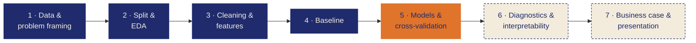

# Fraud Detection in Electricity and Gas Consumption

**Team The Gradient Descenders** · Karl · Mohamed · Hadi · Luca
Zindi challenge for **STEG** (Tunisian electricity and gas company)

> **Who should STEG inspect first?** 5.6 % of customers cheat their meter. We rank every customer by fraud risk, so the same inspection budget finds more fraudsters.

## Results so far

| Model | Who | ROC-AUC (5-fold CV) | Fraudsters per 10,000 inspections* |
|---|---|---|---|
| Random visits | – | 0.500 | 560 |
| Baseline: Logistic Regression on consumption | team | 0.663 | 1,280 |
| XGBoost (with meter codes) | Luca | 0.791 | ≈ 2,210 (test set) |
| Voting Ensemble | Hadi | 0.747 | ≈ 1,680 (test set) |
| **LightGBM** | Mohamed | **0.818** | **≈ 2,430** |

\* 10,000 is an example budget, not a STEG number. Holdout (20 % of customers the models never saw, info only – models are chosen by CV, [ADR-001](ADR.md)): **LightGBM 0.822**.

**Key finding:** `n_counters` (number of meters) is **target leakage**. STEG replaces the meter after it catches a fraudster, so we dropped it ([ADR-015](ADR.md)).

## Project path

The notebook follows 7 stages. Each one ends with a short "Results & Learnings" marker.



Dark blue = done · orange = in progress · dashed = still open

## What is where

| File | What |
|---|---|
| [04_fraud_project.ipynb](04_fraud_project.ipynb) | Main team notebook, stages 1–7 |
| [models/create_xgbc_model.ipynb](models/create_xgbc_model.ipynb) | Luca's XGBoost model |
| [helper.py](helper.py) | Shared `build_features` (used by Luca's model) |
| [models/create_lgbm_model.ipynb](models/create_lgbm_model.ipynb) | Mohamed's LightGBM model (without `n_counters`) |
| [models/create_voting_model.ipynb](models/create_voting_model.ipynb) | Hadi's voting ensemble (LR, KNN, tree, random forest, gradient boosting – all tuned), short version |
| [models/results.csv](models/results.csv) | CV results of all models – each model notebook writes its row (`helper.save_result`), the main notebook reads it in 5.5 |
| [ADR.md](ADR.md) | All project decisions (ADR-001 … ADR-016) |
| [Fraud_Detection_STEG.pdf](Fraud_Detection_STEG.pdf) · [.pptx](Fraud_Detection_STEG.pptx) | Stakeholder presentation (PDF and PowerPoint) |
| [01_assignment.md](01_assignment.md) · [02_kanban_board.md](02_kanban_board.md) | Bootcamp brief and board setup |

## Setup

```bash
uv sync
```

Download the data from the [Zindi challenge page](https://zindi.africa/competitions/fraud-detection-in-electricity-and-gas-consumption-challenge) and unzip it into `data/` (gives `data/train/` and `data/test/`; ignored by git because of size). Then open `04_fraud_project.ipynb` with the `.venv` kernel.
